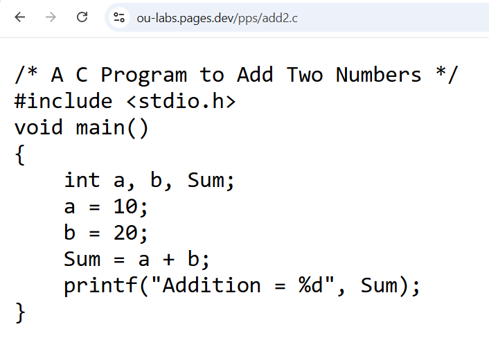

# OU-LABS 🎓 
  
 A clean, organized archive of lab programs for engineering students at Osmania University. 
  
  
 ## 🔗 Quick Access 
 [https://ou-labs.pages.dev](https://ou-labs.pages.dev) 
  
 | Subject | Short Link | 
 |---|---| 
 | Programming for Problem Solving | [ou-labs.pages.dev/pps](https://ou-labs.pages.dev/pps) | 
 | IT Workshop | [ou-labs.pages.dev/it-ws](https://ou-labs.pages.dev/it-ws) | 
 | IT Data Structures | [ou-labs.pages.dev/it-ds](https://ou-labs.pages.dev/it-ds) | 
 | Embedded Systems | [ou-labs.pages.dev/es](https://ou-labs.pages.dev/es) | 
 | Mobile App Development | [ou-labs.pages.dev/mad](https://ou-labs.pages.dev/mad) | 
 | Machine Learning | [ou-labs.pages.dev/ml](https://ou-labs.pages.dev/ml) | 
 | Artificial Intelligence | [ou-labs.pages.dev/ai](https://ou-labs.pages.dev/ai) | 
  
  
  
 ## ⚡ Notable Feature 
 Get any program's code directly in your browser, no GitHub navigation needed. 
  
 

 - [ou-labs.pages.dev/pps/add2.c](https://ou-labs.pages.dev/pps/add2.c) 
 - [ou-labs.pages.dev/es/led-alt.c](https://ou-labs.pages.dev/es/led-alt.c) 
 - [ou-labs.pages.dev/java/method-overloading.java](https://ou-labs.pages.dev/java/method-overloading.java) 
  
 Just type the subject and filename, done. 
  
 ## 📌 Note 
 Programs are based on the OU syllabus. 
 All programs are taken directly from lab records. 
  
 ## 🤝 Contributions 
 Found a missing program? Feel free to open a PR.